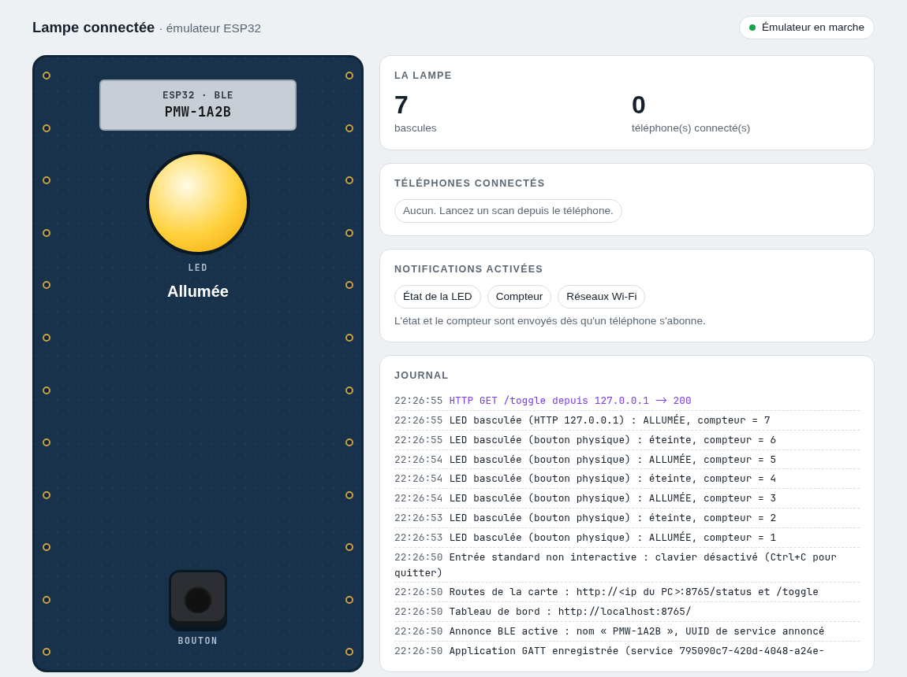

# Émulateur de la lampe connectée (ESP32)

Ce programme transforme votre PC Linux en « lampe connectée » BLE, identique (côté GATT) à l'ESP32 utilisé dans les TP Android BLE. Il passe par le vrai adaptateur Bluetooth du PC : un téléphone Android, avec l'application des stagiaires ou nRF Connect, peut scanner, se connecter, écrire et recevoir des notifications sans aucun ESP32.

Il accompagne les TP Android BLE du site [cours.brosseau.ovh](https://cours.brosseau.ovh) :

- [Android Compose et le BLE (sans librairie)](https://cours.brosseau.ovh/tp/android/compose/android-ble) ;
- [Android Compose et le BLE (librairie Nordic)](https://cours.brosseau.ovh/tp/android/compose/android-ble-nordic).

Il s'appuie sur BlueZ (D-Bus système) et la bibliothèque Python `dbus-fast`. Aucun droit administrateur n'est nécessaire.

## Prérequis

- Linux avec BlueZ 5.50 ou plus récent (testé avec BlueZ 5.87, Arch / Omarchy).
- Un adaptateur Bluetooth compatible LE en rôle périphérique (`Roles: peripheral` dans `bluetoothctl show`).
- Python 3.10 ou plus récent.

## Installation

```bash
git clone https://github.com/c4software/emulateur-lampe-ble.git
cd emulateur-lampe-ble
python3 -m venv .venv
.venv/bin/pip install -r requirements.txt
```

## Lancement

```bash
.venv/bin/python emulateur.py
```

Puis ouvrez le tableau de bord dans un navigateur : **http://localhost:8080/**

Au démarrage, la lampe s'annonce sous le nom `PMW-XXXX`, où `XXXX` reprend les 4 derniers chiffres de l'adresse de l'adaptateur (ici `PMW-D708`). Si un nom a été enregistré (via BLE ou `--name`), c'est lui qui est utilisé.

### Le tableau de bord



La page simule la carte et se met à jour en direct :

- la **LED** s'allume et s'éteint comme sur l'ESP32 (y compris pendant un motif) ;
- le **bouton** de la carte est cliquable (ou touche `b` dans la page) : il bascule la LED et notifie les téléphones abonnés ;
- le nombre de bascules, les **téléphones connectés** et les **notifications activées** (État de la LED, Compteur, Réseaux Wi-Fi) ;
- le **journal** : connexions, écritures reçues, notifications envoyées.

Projetée au tableau, elle permet de montrer à la salle ce que reçoit « la lampe » quand un participant clique dans son application.

### Touches (terminal)

| Touche | Action |
|---|---|
| `b` | Appui sur le bouton physique : bascule la LED et notifie l'état et le compteur |
| `e` | Affiche l'état (LED, compteur, abonnements actifs) |
| `w` | Renvoie la liste des réseaux Wi-Fi simulés |
| `h` | Aide |
| `q` | Quitter (Ctrl+C fonctionne aussi) |

Le journal affiche les connexions, les abonnements, les écritures reçues et les notifications envoyées.

### Options

| Option | Rôle |
|---|---|
| `--name PMW-Demo` | Nom annoncé pour cette exécution (prioritaire sur le nom enregistré, n'écrase pas le fichier) |
| `--adapter hci1` | Adaptateur à utiliser (défaut : `hci0`) |
| `--state-file fichier.json` | Fichier de persistance (défaut : `etat-lampe.json` à côté du script) |
| `--http 8080` | Port du tableau de bord et des routes `/status` et `/toggle` (défaut : `8080`) |
| `--no-http` | Désactive le tableau de bord et les routes HTTP |
| `--no-notify-on-subscribe` | N'envoie pas l'état et le compteur juste après l'abonnement (voir plus bas) |
| `--alias-adapter` | Renomme aussi l'adaptateur Bluetooth du PC avec le nom de la lampe, puis le restaure à l'arrêt |
| `--pattern-step 250` | Durée d'un pas de motif LED, en millisecondes |
| `-v`, `--verbose` | Journal détaillé |

Pour repartir de zéro (nom par défaut, Wi-Fi oublié), supprimez `etat-lampe.json`.

## Table GATT

Service principal : `795090c7-420d-4048-a24e-18e60180e23c` (présent dans l'annonce, le filtre de scan `ServiceUuid` fonctionne).

| Caractéristique | UUID | Propriétés | Comportement |
|---|---|---|---|
| TOGGLE_LED | `59b6bf7f-44de-4184-81bd-a0e3b30c919b` | WRITE | Toute écriture bascule la LED, quelle que soit la valeur (`"1"`, `"0"`…), comme sur la carte : compteur + 1, notification de l'état et du compteur. Seule exception : une suite de `0`/`1` de plusieurs caractères (ex. `1010100011101110111000101010`) joue un motif. |
| LED_STATE | `d75167c8-e6f9-4f0b-b688-09d96e195f00` | NOTIFY | `"1"` (allumée) ou `"0"` (éteinte), à chaque changement |
| TOGGLE_COUNT | `a877d87f-60bf-4ad5-ba61-56133b2cd9d4` | NOTIFY | Nombre de bascules en texte (`"0"`, `"1"`…), à chaque changement |
| DEVICE_NAME | `1497b8a8-64f8-11ee-8c99-0242ac120002` | WRITE | Nouveau nom en UTF-8, enregistré dans `etat-lampe.json` et réannoncé immédiatement. Un nom vide est refusé. |
| WIFI | `10f83060-64f8-11ee-8c99-0242ac120002` | WRITE, NOTIFY | **Simulé**, voir ci-dessous |

Les caractéristiques NOTIFY ne sont pas lisibles, comme sur l'ESP32. Le compteur et l'état de la LED repartent à zéro à chaque lancement ; seuls le nom et les identifiants Wi-Fi sont persistants.

Côté émulateur, toutes les sources de bascule (BLE, bouton du tableau de bord ou touche `b`, HTTP) notifient les clients abonnés.

### Notification à l'abonnement (option activée par défaut)

Dès qu'un client s'abonne à LED_STATE ou TOGGLE_COUNT, l'émulateur envoie la valeur courante (100 ms après l'abonnement). L'application basée sur la librairie Nordic affiche ainsi l'état tout de suite au lieu de « État de la LED inconnu ».

D'après le TP (`android-ble-nordic.md`, « l'état apparaît au premier changement »), **le vrai firmware ne le fait pas**. Pour reproduire exactement l'ESP32, lancez avec `--no-notify-on-subscribe`. Le code source du firmware n'a pas été retrouvé, ce point repose donc sur le texte du TP.

Limite BlueZ : l'abonnement est commun à tous les clients. Si deux téléphones sont connectés, seul le premier abonnement déclenche l'envoi de la valeur initiale.

### Wi-Fi (simulé)

Le format exact du firmware n'est pas connu. L'émulateur propose un comportement plausible :

- à l'abonnement, il notifie une liste de réseaux fictifs, **une notification par SSID** (`Livebox-4F2A`, `Freebox-8C1D`, `Salle-TP-BLE`, `eduroam`, `SFR_WiFi_FON`) ;
- une écriture `{"ssid": "...", "password": "..."}` (JSON) ou `ssid;motdepasse` enregistre les identifiants dans `etat-lampe.json` ;
- toute autre écriture (par exemple `scan`) renvoie la liste des réseaux.

Aucune connexion Wi-Fi réelle n'est faite.

### Motif LED

Le sujet « Télécommande Bluetooth & Réseau » mentionne l'animation de la LED avec une chaîne comme `1010100011101110111000101010` (SOS). Hypothèse retenue faute de source : la chaîne est écrite sur TOGGLE_LED, chaque caractère dure 250 ms, l'état est notifié à chaque pas, le compteur ne change pas et la LED reprend son état initial à la fin.

## Routes HTTP de la carte

Elles sont servies sur le même port que le tableau de bord :

```bash
curl http://localhost:8080/status    # {"state": "OFF", "count": 0}
curl http://localhost:8080/toggle    # {"state": "ON", "count": 1}
```

Routes et format repris du sujet `tp/android/view/app-ble-network.md` (`/status`, `/toggle`, réponse `{state: "ON", count: 0}`). Le firmware écoute sur le port 80 et seulement après configuration du Wi-Fi ; l'émulateur utilise le port choisi (un port inférieur à 1024 demanderait les droits root) et démarre le serveur dès le lancement (désactivable avec `--no-http`). La méthode HTTP attendue n'étant pas documentée, GET et POST sont acceptés. Depuis le téléphone, utilisez l'adresse IP du PC sur le même réseau (et `android:usesCleartextTraffic="true"`).

## Tests

```bash
.venv/bin/python -m unittest -v
```

- `tests/test_etat.py` : logique de la lampe (bascule, compteur, motif, renommage persistant, notification à l'abonnement, Wi-Fi).
- `tests/test_dbus.py` : couche D-Bus sur le bus de session (le test joue le rôle de BlueZ : `StartNotify`, `WriteValue`, notifications). Aucun adaptateur n'est utilisé.

## Dépannage

**L'adaptateur est-il présent et allumé ?**

```bash
bluetoothctl show        # Powered: yes, Roles: peripheral
rfkill list              # Soft blocked: no / Hard blocked: no
bluetoothctl power on    # si Powered: no
rfkill unblock bluetooth # si Soft blocked: yes
```

**L'annonce est-elle active ?** Pendant que l'émulateur tourne, `bluetoothctl show` doit afficher `ActiveInstances: 0x01` (ou plus) dans « Advertising Features ». Si cette section est absente, l'adaptateur ou le noyau ne permet pas l'annonce LE.

**`RegisterAdvertisement` ou `RegisterApplication` échoue.** Vérifiez que le service tourne (`systemctl status bluetooth`). Une erreur `Maximum advertisements reached` signifie que d'autres programmes annoncent déjà ; une erreur `Access denied` vient de la politique D-Bus de BlueZ (`/usr/share/dbus-1/system.d/bluetooth.conf`), à faire corriger par l'administrateur du poste. Les options expérimentales de `bluetoothd` (`--experimental`) ne sont **pas** nécessaires.

**Le téléphone ne voit pas la lampe.** Le nom est placé dans la réponse de scan (l'annonce contient les drapeaux et l'UUID du service) : utilisez un scan actif (comportement par défaut d'Android et de nRF Connect). Rapprochez le téléphone, vérifiez que la localisation et le Bluetooth du téléphone sont activés. Au-delà de 29 octets, le nom est tronqué.

**Le nom affiché n'est pas le bon.** Android met en cache le nom et la table GATT d'une adresse. Comme le PC garde toujours la même adresse Bluetooth, après un renommage :

- dans nRF Connect, menu de l'appareil, « Refresh device cache » ;
- sinon désactivez puis réactivez le Bluetooth du téléphone ;
- si le PC et le téléphone sont appairés (casque, partage de connexion…), supprimez l'appairage côté téléphone.

Après connexion, Android peut aussi lire le nom GAP (caractéristique `0x2A00`), qui est le nom de l'adaptateur du PC (par exemple `mon-ordinateur`) et non celui de la lampe. Pour l'aligner, lancez avec `--alias-adapter` : l'alias de l'adaptateur est changé pendant l'exécution puis restauré à l'arrêt (s'il est interrompu brutalement, restaurez-le avec `bluetoothctl system-alias <nom>`).

**Le journal indique des « Client connecté » inattendus.** Les connexions de tous les appareils Bluetooth du PC (casque, souris…) sont affichées.

**Le terminal reste en mode bizarre après un plantage.** Tapez `reset`.

## Fichiers

| Fichier | Rôle |
|---|---|
| `emulateur.py` | Point d'entrée, options, clavier |
| `lampe/gatt.py` | UUID et table GATT |
| `lampe/etat.py` | Logique de la lampe et persistance JSON (sans Bluetooth) |
| `lampe/ble.py` | Application GATT et annonce BlueZ via D-Bus |
| `lampe/http.py` | Serveur HTTP : tableau de bord, flux en direct, `/status` et `/toggle` |
| `lampe/diffusion.py` | Diffusion en direct de l'état et du journal vers le tableau de bord |
| `lampe/web/index.html` | La page du tableau de bord (autonome, fonctionne hors ligne) |
| `lampe/console.py` | Journal coloré et lecture des touches |
| `tests/` | Tests automatisés |
